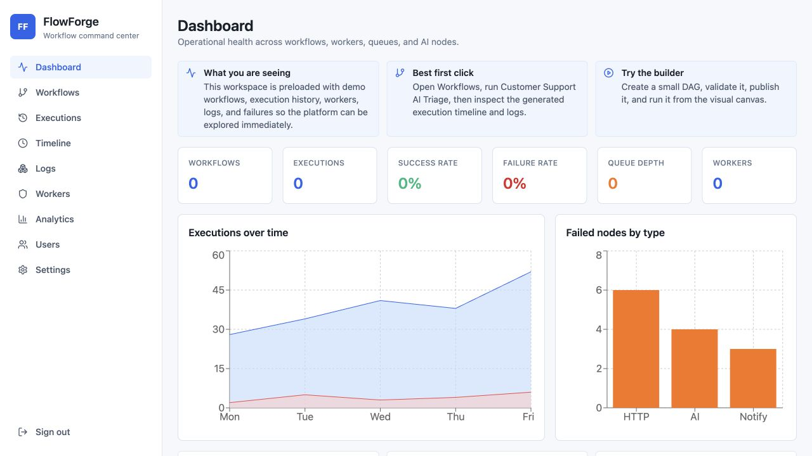
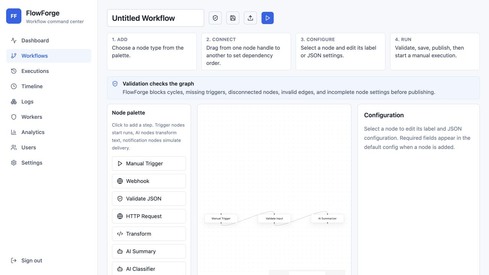
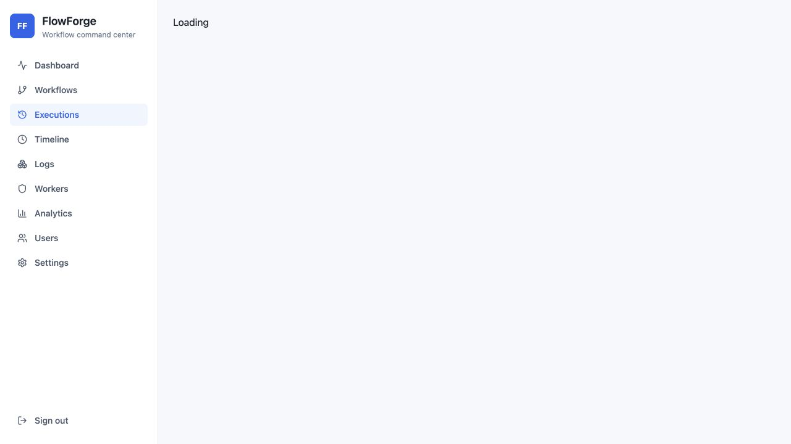
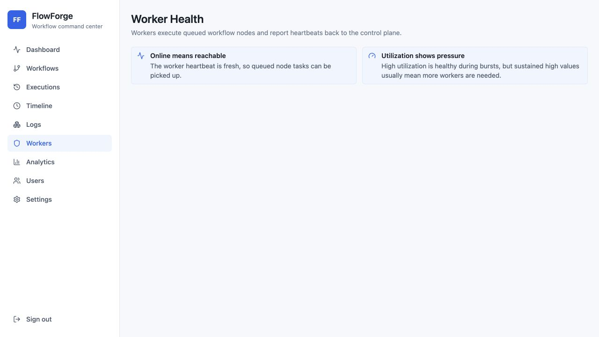
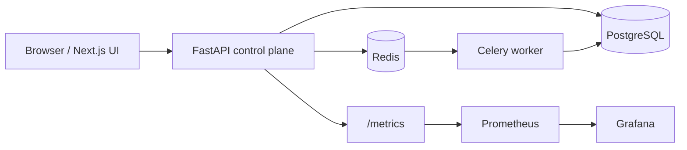

# FlowForge

[](https://github.com/KevanMehta/FlowForge/actions/workflows/ci.yml)
[](LICENSE)

FlowForge is a reference implementation of a workflow orchestration system for creating, validating, and running DAG-based workflows.



## Why I Built This

I built FlowForge to understand the moving parts behind tools like Airflow, Temporal, GitHub Actions, LangGraph, and n8n without copying any one of them directly.

The project focuses on the engineering problems that make workflow systems interesting:

- representing workflows as directed acyclic graphs
- validating graph structure before execution
- planning dependency-aware execution
- recording node-level state, retries, logs, and artifacts
- exposing enough UI and observability for a reviewer to understand what happened during a run

This is a portfolio project and local demo. Some infrastructure pieces are intentionally simplified and documented in [Tradeoffs](#tradeoffs).

## Features

- JWT login flow with bcrypt password hashing and role-based access checks.
- Admin, developer, and viewer roles.
- Workflow CRUD, graph validation, versioning, publish, rollback, and manual runs.
- Graph validation for cycles, disconnected nodes, invalid edges, missing trigger nodes, and invalid node configuration.
- Execution planner that groups independent nodes into topological levels.
- Celery/Redis worker structure with persisted execution, node execution, retry, lease, log, artifact, dead-letter, and heartbeat records.
- Execution reliability primitives: idempotency keys, node leases, duplicate-task prevention, retry scheduling, timeout detection, cancellation, and stale lease recovery.
- Inline local execution path so demo runs are visible immediately after `docker compose up --build`.
- Workflow node registry with trigger, validation, HTTP, transform, AI, conditional, delay, notification, and report node types.
- AI nodes with deterministic local fallback when `OPENAI_API_KEY` is not set.
- Prometheus metrics endpoint and Grafana dashboard provisioning.
- React Flow workflow builder with node palette, edge creation, node configuration, validation, save, publish, and run actions.
- Dashboard, workflow list/detail, execution detail, logs, timeline, worker health, analytics, admin users, and settings pages.

## Screenshots

| Workflow Builder | Execution Detail |
| --- | --- |
|  |  |

| Worker Health | Dashboard |
| --- | --- |
|  |  |

## Architecture



The FastAPI service owns authentication, RBAC, workflow APIs, graph validation, execution records, schedules, metrics, analytics, and audit logging.

PostgreSQL stores users, workflows, workflow versions, graph nodes/edges, executions, node executions, logs, artifacts, schedules, worker heartbeats, audit logs, API keys, dead-letter tasks, notification events, and system metrics.

Redis and Celery model the worker plane. The demo also includes an inline execution path so a local reviewer can run workflows without waiting on a distributed worker topology.

More detail is available in:

- [Architecture](docs/architecture.md)
- [Workflow engine](docs/workflow-engine.md)
- [API overview](docs/api.md)
- [Security notes](docs/security.md)
- [Deployment notes](docs/deployment.md)
- [Architecture decisions](docs/decisions.md)

## Engineering Decisions

- **FastAPI instead of Spring Boot or Django:** keeps the API layer small, typed, and easy to inspect through generated OpenAPI docs.
- **PostgreSQL instead of MongoDB:** workflow state is relational: users, versions, executions, node executions, logs, and artifacts benefit from foreign keys and explicit queries.
- **Redis and Celery instead of Temporal:** Celery is simpler to run in a portfolio repo and makes the queue/worker boundary visible. Temporal would be a better choice for durable production orchestration, but it adds more operational weight than this demo needs.
- **React Flow for the builder:** graph editing is the core UI interaction, and React Flow provides a proven canvas model without hand-rolling node/edge behavior.
- **Docker Compose for local setup:** the project needs several services, and Compose keeps the demo reproducible on one machine.
- **Deterministic AI fallback:** AI nodes should be testable and usable without a paid API key. When `OPENAI_API_KEY` is missing, the project uses local deterministic behavior.

ADR-style notes are in [docs/decisions.md](docs/decisions.md).

## Engineering Tradeoffs

- Workflow execution is persisted and worker-aware, but the local demo also runs inline so the UI responds immediately.
- Node leases and retry metadata are modeled in the database. This demonstrates the reliability boundary, but it does not replace a durable workflow engine.
- Notification nodes simulate email and Slack delivery and store events locally.
- AI node behavior is deterministic unless an OpenAI API key is provided.
- OAuth-ready structure exists, but external OAuth providers are not wired.
- Terraform files are deployment starters, not a complete cloud environment.
- The test suite covers planner, graph validation, local AI node behavior, execution state transitions, lease handling, retry/dead-letter behavior, and a small frontend component test. It is not exhaustive.

## Local Setup

```bash
docker compose up --build
```

After startup:

- Frontend: http://localhost:3000
- Backend API: http://localhost:8000
- Swagger Docs: http://localhost:8000/docs
- Health: http://localhost:8000/health
- Metrics: http://localhost:8000/metrics
- Grafana: http://localhost:3001
- Prometheus: http://localhost:9090

## Demo Credentials

```text
Admin:     admin@flowforge.dev / Password123!
Developer: developer@flowforge.dev / Password123!
Viewer:    viewer@flowforge.dev / Password123!
```

## Demo Walkthrough

1. Start the stack with `docker compose up --build`.
2. Open http://localhost:3000 and sign in as the admin demo user.
3. Open **Workflows** and inspect one of the seeded workflows.
4. Open **Workflow Builder** to validate, save, publish, and run a DAG.
5. Open **Executions** and inspect status, node attempts, logs, and artifacts.
6. Open **Worker Health** and **Analytics** to review queue and reliability signals.

## Testing

```bash
./scripts/test.sh
```

The current test suite includes:

- Pytest coverage for graph validation.
- Pytest coverage for execution planning.
- Pytest coverage for execution state transitions, worker lease handling, retry scheduling, and dead-letter behavior.
- Pytest coverage for deterministic local AI node behavior.
- Vitest/React Testing Library coverage for a frontend KPI component.
- GitHub Actions jobs for backend lint/format/tests, frontend lint/tests/build, and Docker build validation.

## Project Structure

```text
backend/   FastAPI app, SQLAlchemy models, routers, services, worker tasks, scheduler, seed data, tests
frontend/  Next.js app, React Flow builder, API client, hooks, shared UI components, frontend tests
infra/     Nginx, Prometheus, Grafana, and Terraform starter templates
docs/      Architecture, API, workflow engine, security, deployment, and decision notes
scripts/   Local helper scripts for development, seeding, and tests
.github/   CI workflow, issue templates, pull request template, and Dependabot config
```

## Future Improvements

- Replace inline demo execution with full distributed fan-out/fan-in using Celery primitives or a workflow engine.
- Add WebSocket or Server-Sent Events updates for live execution status.
- Add OAuth providers.
- Expand API and frontend tests around RBAC and execution failure paths.
- Add multi-tenant workspace isolation.
- Add reproducible benchmark scripts before making performance claims.


## License

This project is licensed under the MIT License.
